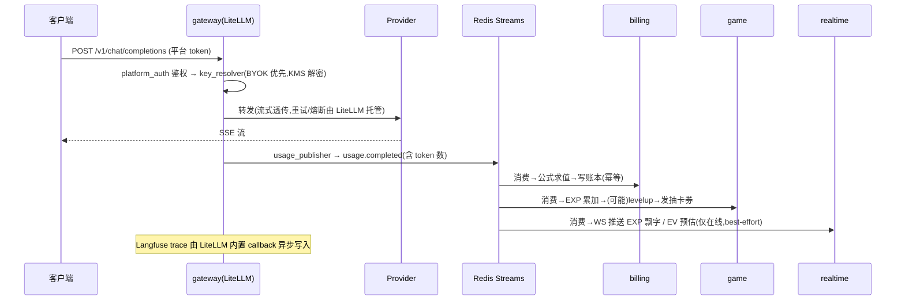
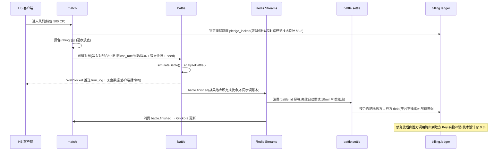

# Mogwai 技术架构设计

> Architecture Design v0.5 · 配套文档:[技术设计](./tech-design.md) · [产品文档(H5)](./product.html)
>
> 本文分两部分:**Part A 顶层技术架构**(组件选型与边界契约)、**Part B 代码概要设计**(模块、数据模型、时序)。

---

# Part A · 顶层技术架构

## A1. Top-Level 架构图(含组件选型)

```mermaid
flowchart TB
    subgraph clients [接入层]
      HARN[harness 插件(首选接入)<br/><b>harness-core + 各 harness 适配</b><br/>首发:DeepSeek Harness(dsh)]
      APP[用户应用 / IDE / Agent<br/><i>任意 OpenAI 兼容 SDK(兜底接入)</i>]
      WEB[控制台 + 对战 H5<br/><b>Next.js</b> App Router]
      TSDK[行为采集<br/><b>tracking-sdk(仅控制台)</b>]
    end

    subgraph edge [网关层 · 独立部署 · 可替换运行时]
      GW[LLM Gateway<br/><b>LiteLLM Proxy(自托管)</b><br/>+ mogwai 插件 ×3:<br/>platform_auth / key_resolver / usage_publisher]
    end

    subgraph app [应用层 · core-app<br/><b>NestJS 模块化单体</b>(API + Worker 两种入口)]
      ACC[account<br/>用户/认证/Key 托管]
      BILL[billing<br/>公式引擎 + 复式账本]
      TELE[telemetry<br/>事件入库/关联]
      GAME[game<br/>EV/EXP/抽卡/日报]
      MATCH[match<br/>Glicko-2 匹配]
      BATTLE[battle<br/>模拟/复盘/结算]
      RT[realtime<br/><b>Socket.IO</b> 推送]
      ADMIN[admin<br/>配置中心/后台]
    end

    subgraph data [数据与基础设施层]
      RD[(<b>Redis 7</b><br/>Streams 事件总线<br/>+ 匹配队列 + 缓存)]
      PG[(<b>PostgreSQL 16</b><br/>业务 + 账本<br/>ORM: drizzle)]
      CH[(<b>ClickHouse</b><br/>行为事件 + EV 特征<br/>与 Langfuse 共用实例)]
      LF[<b>Langfuse v3 自托管</b><br/>LLM trace / prompt 观测]
      KMS[<b>云 KMS / OpenBao Transit</b><br/>Provider Key 信封加密]
    end

    HARN -->|路由配置:模型流量仍全部经网关| GW
    HARN -->|behavior.tracked(批量,平台 token)| TELE
    APP -->|/v1/chat/completions| GW
    WEB -->|REST| app
    RT -.->|Socket.IO 推送| WEB
    TSDK -->|behavior.tracked| TELE
    GW -->|读三投影:token / Key / 授权| RD
    GW -->|usage.completed| RD
    GW -->|trace(内置 callback)| LF
    GW -->|解密 DEK| KMS
    RD -->|领域事件(消费组互相独立)| app
    app --> PG
    app --> CH
    ACC --> KMS
```

> 本图同步嵌入 [README](../README.md);改动时两处一起更新。

三条铁律:

1. **网关是可替换运行时**:对上只承诺两种 wire format(OpenAI 兼容 API + Anthropic `/v1/messages`,后者是 Claude Code 接入的硬需求,见技术设计 §2.2),对下只承诺 `usage.completed` 事件 schema,自定义逻辑全部收敛在 3 个薄插件里 → 换掉 LiteLLM(Bifrost / 自研)时两侧无感;
2. **网关不碰业务**:只依赖 Redis + KMS,core-app 全挂不影响 AI 代理主链路;**权威计费在 billing 公式引擎,LiteLLM 自带的 spend tracking 仅作对账参考**;
3. **跨进程只走事件**:gateway 与 core-app 之间无 RPC,全部经 Redis Streams,消费组互相独立。

## A2. 自研 / 复用的判定原则

每个组件先问一个问题:**它是不是差异化资产?**

- **是(必须自研,复用即失去产品)**:CP 折算公式的语义与审计链、EV 特征体系与事件 schema、battle-core 数值引擎、匹配规则(质押档/战力/反喂分)。这些自研的共同点:纯逻辑、无 IO、代码量小、但规则就是产品本身;
- **否(必须复用,自研即浪费)**:协议适配、认证会话、任务队列、trace 存储、密钥托管、推送通道。这些复用的共同点:工程量大、无差异化、开源方案有成熟运维经验;
- 所有复用组件必须给出**替换触发条件**,并保证替换成本被接口封装锁定。

## A3. 组件选型清单

> 每行给出:选型、承担职责、备选项与**替换触发条件**。选型论证不在本文档。

**网关层**

| # | 组件 | 选型 | 承担职责 | 备选 / 替换触发条件 |
|---|---|---|---|---|
| 1 | LLM 网关运行时 | **LiteLLM Proxy**(自托管,MIT) | 双协议代理(OpenAI 兼容 + Anthropic `/v1/messages`)、100+ provider 适配、流式、重试/fallback/熔断、负载均衡 | **Bifrost**(Go)或自研:单实例 > 300 RPS、或网关自身 P99 开销 > 100ms 时替换(agent 流量大上下文高频,触发概率偏高,预案保持热备) |
| 2 | 网关自定义逻辑 | **自研 LiteLLM 插件(Python ×3)** | platform_auth / key_resolver / usage_publisher(见 A4) | 插件保持"薄、无业务规则",否则替换运行时成本失控 |
| 3 | 网关限流 | LiteLLM 内置 rpm/tpm(按平台 token) | 防单用户打爆 Key 池 | — |
| 4 | token 估算 | LiteLLM 内置计数;缺 usage 时 **tiktoken** 估算 | usage 兜底,打 `estimated` 标 | — |

**应用层**

| # | 组件 | 选型 | 承担职责 | 备选 / 替换触发条件 |
|---|---|---|---|---|
| 5 | 应用框架 | **NestJS 模块化单体** | 全部业务域,API 与 Worker 同镜像双入口 | 单模块负载/团队规模触发时按模块拆微服务(边界已按此设计) |
| 6 | 认证/身份 | **better-auth**(TS 嵌入式,drizzle 适配) | 注册登录、OAuth 社交登录、会话、2FA | Logto:需要独立 IdP / 多应用 SSO 时;Keycloak:企业 SAML/LDAP 需求时 |
| 7 | 平台 API token | **better-auth api-key 插件**(`sk_` 前缀、哈希存储、限流、元数据) | 签发用户调网关用的平台 token;**token 哈希投影到 Redis 供网关插件验证**(网关不触 PG) | — |
| 8 | 任务队列/定时 | **BullMQ**(Redis 之上) | Key 巡检、结算补偿、冻结兜底扫描、每日 usage 对账、EV 日结调度 | Temporal:出现跨天长事务/复杂工作流时 |
| 9 | 实时推送 | **Socket.IO**(NestJS 内嵌) | EXP 飘字、战斗演出、日报通知 | Centrifugo:在线长连接 > 5 万时外置 |
| 10 | 前端 | **Next.js**(App Router) | 控制台 + 对战 H5 双分区 | — |

**游戏域**

| # | 组件 | 选型 | 承担职责 | 备选 / 替换触发条件 |
|---|---|---|---|---|
| 11 | 匹配器 | **自研**(Redis ZSET 队列 + 2s 撮合扫描) | rating 渐宽窗口、质押同档、战力阈值、反喂分过滤 | 已评估并否决:Open Match(OM1 已归档,OM2 preview 且为 K8s 重型数据层)、Nakama(完整游戏后端,与自有账户/账本域重叠)、Colyseus(实时房间同步,不适配异步自动战斗) |
| 12 | 评分算法 | **glicko2**(npm 现成实现) | 对战评分与 RD 更新 | — |
| 13 | 战斗引擎 | **自研 battle-core**(TS 纯函数) | 确定性回合模拟 + 复盘归因,前后端同构 | 无成熟开源可买;性能瓶颈时同接口下沉 Rust/WASM |
| 14 | 排行榜 | Redis ZSET(**match 模块赛季子域**;realtime 只负责推送通道) | 赛季/段位榜 | — |
| 15 | 公式 DSL | **expr-eval**(TS,沙箱求值) | CP 折算公式、EV 权重等可配置表达式 | cel-js / QuickJS 沙箱:需要更复杂控制流时 |
| 16 | 配置中心 | **自建 config_versions 表**(版本化/灰度/审计/沙箱回放) | 公式、EV 权重、概率表、战斗参数 | Unleash:仅适用纯功能开关,不满足版本化 payload 审计,故不采用为主方案 |

**数据与可观测层**

| # | 组件 | 选型 | 承担职责 | 备选 / 替换触发条件 |
|---|---|---|---|---|
| 17 | OLTP | **PostgreSQL 16** + drizzle | 用户、Key、复式账本、游戏资产、配置中心 | — |
| 18 | 事件总线 | **Redis Streams**(消费组) | 全部领域事件 | Kafka:> 5k msg/s、需长回溯时迁移;代码依赖自建 `EventBus` 抽象 |
| 19 | OLAP | **ClickHouse**(与 Langfuse v3 共用实例) | 行为事件原始表、EV 特征物化视图 | 资源冲突时拆独立实例 |
| 20 | LLM 观测 | **Langfuse v3**(自托管) | prompt/completion/trace 存储、会话关联 | Helicone / Phoenix;接口层抽象为 TelemetrySink |
| 21 | 行为采集 | **harness 插件**(harness-core + 各 harness 适配,见 A6)+ tracking-sdk(浏览器,仅控制台) | harness 会话事件 → 规范化行为事件 → telemetry ingest API;**低信任辅助面,锚定网关流量核验**(EV 权威数据源仍是网关流量,技术设计 §4.2) | PostHog:事件 schema 是 EV 体系核心资产,不外包 |

**安全与运营**

| # | 组件 | 选型 | 承担职责 | 备选 / 替换触发条件 |
|---|---|---|---|---|
| 22 | 密钥管理(KEK) | **云 KMS**(生产)/ **OpenBao Transit**(自托管,Vault 开源分叉)/ age(本地开发) | Provider Key 信封加密的 KEK 层,三实现同接口按环境切换 | — |
| 23 | 数据加密(DEK) | Node `crypto` AES-256-GCM | 每条 Key 独立 DEK,密文落库 | — |
| 24 | 应用限流 | @nestjs/throttler + Redis | 事件 API、对战 API 防刷 | — |
| 25 | 运营后台 | 自建最小 admin 页面 + **Metabase**(自托管,接 PG/CH 只读副本) | 配置中心操作走自建(要审计);数据分析看板走 Metabase | Appsmith:后台表单需求膨胀时 |
| 26 | 支付/充值 | **暂缓**(M4 后决策:Stripe / 微信支付宝) | CP 充值 | 上线前完成合规评估再选 |
| 27 | Monorepo | **pnpm workspace + Turborepo** | TS 代码共享 | — |

## A4. 网关层设计(LiteLLM 落地方式)

```
gateway/(独立部署单元,非 TS monorepo 的一部分;详见 gateway/README.md)
├── litellm-config.yaml        # 模型清单(5 provider 通配路由)、重试/熔断参数
├── Dockerfile                 # litellm 官方镜像 + 插件 + JSON Schema 契约工件
├── plugins/                   # mogwai 扩展,薄、无业务规则
│   ├── mogwai_common.py       # Redis 连接、env 配置、投影/流命名(镜像 shared)
│   ├── kms.py                 # KMS 客户端接口:env_kek(dev)/ openbao_transit / 云 KMS(M4+)
│   ├── spool.py               # usage 事件本地 spool(独立模块,可单测)
│   ├── platform_auth.py       # custom_auth hook:平台 API token → user_id(+软授权预检)
│   ├── key_resolver.py        # pre-call hook:查 Redis 投影 → 债务清偿路由 > BYOK > 平台池
│   │                          #   → KMS 解密(内存中用完即弃)→ 注入本次请求
│   └── usage_publisher.py     # success/failure callback:组装 usage.completed
│                              #   → 按 JSON Schema 契约工件校验 → XADD 到 Redis Streams
└── tests/                     # pytest 集成测试:真实 Redis + 真实 LiteLLM + 上游测试替身
```

- **三个 Redis 投影,保证网关不触 PostgreSQL**(account / billing 在数据变更时写入,网关只读):
  1. 平台 token 投影:「token 哈希 → user_id / 限流参数 / privacy_mode / 拒绝标记」(token 由 better-auth api-key 插件签发,见 A3 #7);
  2. Key 路由投影:「user → provider keys(密文)+ 模型白名单」;
  3. 授权投影:「user → 服务费欠费 / 担保额度 / 未清偿债权债务 / 拒绝标记」——platform_auth 据此做**软授权**,key_resolver 据此做**债务清偿路由**(胜方调用优先走债务人 Key,技术设计 §2.5/§10.3);规则在 billing,网关只做数值比较;
- **平台自营 Key 池与用户 Key 同等管理**:由 admin 录入、同样信封加密、经 Key 路由投影下发;`litellm-config.yaml` 不落任何 Key 明文;
- **usage_publisher 可靠性**:XADD 失败写本地 spool 循环重投,配合每日对账任务(见技术设计 §2.3);
- **Langfuse**:用 LiteLLM 内置 callback 直连,trace_id 回填进 usage 事件;`privacy_mode` 用户只写脱敏摘要,明文不出网关;
- **不使用** LiteLLM 的:计费(平台 CP 权威计费在 billing)、虚拟 Key 体系(平台 token 由 account 签发)、其 Admin UI(仅运维可见)。

## A5. 事件契约(跨进程唯一接口)

| Topic | 生产者 | 消费者 |
|---|---|---|
| `usage.completed` | gateway(usage_publisher) | billing / game.exp / telemetry / realtime |
| `behavior.tracked` | harness 插件 / tracking-sdk → telemetry ingest API | game.ev |
| `ev.settled`(日结) | game.ev worker | game(面板重算)/ game.report |
| `ev.report.generated` | game.report | realtime(日报通知) |
| `trainer.levelup` | game.exp | game.gacha(发券)/ realtime |
| `battle.finished` | battle.engine | battle.settle / battle.analysis / match |
| `settlement.done` | billing.ledger | realtime / match(排行榜) |

- 所有事件带 `event_id`(UUID)幂等键与 `schema_version`(消费者向后兼容一版),消费者各自去重;
- schema 以 `packages/shared` 中的 zod 定义为权威(gateway 的 Python 侧按 JSON Schema 导出物校验);
- 消费组独立位点,单个下游故障不影响其他下游;
- **结算等有经济后果的消费,只依据事件引用的「合约」执行**(技术设计 §1.5),不回读配置中心。

## A6. Harness 插件层(接入与行为采集的客户端形态)

> 2026-08-19 产品转向:agent harness 开放插件生态后(首发 DeepSeek Harness,下称 dsh),
> 接入形态从「用户手改 base URL」升级为「装一个插件」。插件同时解决**接入**(挂载模型路由
> 指向网关)与**行为采集**(订阅 harness 会话事件)。两项实现取舍待裁定:采集通道
> (REVIEW Block 17)、路由挂载方式(REVIEW Block 18)。

**分层:一套 vendor 中立核心 + 每 harness 一个薄适配**(与「网关是可替换运行时」同构;
后续厂商跟进类似插件生态时只加适配器):

| 组件 | 职责 | 约束 |
|---|---|---|
| `packages/harness-core`(vendor 中立) | 规范化行为事件模型(schema 权威在 `packages/shared`)、批量上报客户端(spool / 重试 / 幂等键)、隐私过滤(明文 → 统计特征) | **零 harness 依赖**;上报协议不出现任何 harness 品牌概念 |
| `packages/harness-dsh`(dsh 适配,npm 发布 + `dsh-plugin` topic) | Cordis 插件:① 挂载模型路由(网关 baseURL + 平台 token);② 订阅 `session/event`,映射为规范化事件交给 harness-core | 薄、无业务规则;dsh 处 developer preview **无兼容承诺**,依赖版本必须 pin,破坏性变更由本层吸收 |

**dsh 关键事实**(2026-08 调研,源:dsh 仓库 docs/capability-seams、subsystems/{session,session-telemetry,llm-streaming}):

- 一切皆插件(Cordis 框架):插件 = `apply` 函数 + Schemastery Config;`dsh plugin add <npm 包>` 安装进 profile;unload 自动回收全部 effect;
- **模型路由**:内置 `llm-pi-ai` 适配器支持声明式 provider 路由(`api: openai-completions | anthropic-messages` + `baseURL` + `apiKeyEnv`)——两种 wire format 恰好都是我们网关的既有承诺(A1 铁律 1),指向网关即可,无需自写 LlmAdapter;
- **行为数据**:append-only SessionEvent 日志可经 `session/event` 实时订阅;token 用量在 `assistant/chunk{type:'usage'}`(兜底 `assistant/message.usage`),工具调用 `tool/call`/`tool/result`,轮次 `turn/start`/`turn/end`(带结束原因),请求重试 `llm/retry`;seq 连续,天然幂等键 `(session_id, event_seq)`;
- 官方遥测接缝 `ctx.sessionTelemetry` 自带脱敏瀑布与共享政策披露,但**一进程仅一后端**(与用户自己的 OTel 后端互斥)——取舍见 REVIEW Block 17。

**边界铁律**(数据面分级见技术设计 §1.4 #5,插件不改变它):

1. **模型流量必须经网关**:插件只做路由配置,自身不代理流量——权威计费面、Key 托管、债务清偿全部不变;
2. **插件上报是低信任辅助面**:客户端数据均为用户自述、可伪造,只进练习赛与成长展示;与网关 `usage.completed` 交叉核验(同窗口 token 量级、provider/model 一致)后方可进 EV 特征;
3. **隐私红线比网关更严**:插件默认只上报统计特征(长度 / hash / 结构),prompt 明文不出用户机器;
4. **上报走 telemetry ingest API**(平台 token 鉴权,B4.1),入 `behavior.tracked` 流(A5)——tracking-sdk 与 harness 插件共用同一条低信任通道,消费侧无需区分来源品牌。

---

# Part B · 代码概要设计

## B1. Monorepo 目录结构

```
mogwai/
├── gateway/                        # LLM 网关(LiteLLM 配置 + Python 插件,见 A4;独立部署)
│
├── apps/
│   ├── core-app/                   # 模块化单体(NestJS)
│   │   └── src/
│   │       ├── modules/
│   │       │   ├── account/        #   用户与会话(better-auth)、平台 token 签发(自研,sha256 落库)、
│   │       │   │                   #   Provider Key 托管(录入/校验/状态机/Redis 投影×2)
│   │       │   ├── billing/        #   ├─ formula/   折算公式版本管理 + 沙箱回放
│   │       │   │                   #   ├─ ledger/    复式账本(冻结/结算/幂等)
│   │       │   │                   #   └─ pricing/   价格表同步
│   │       │   ├── telemetry/      #   事件 API、ClickHouse 写入、Langfuse 关联
│   │       │   ├── game/           #   ├─ ev/        特征→EV 引擎(权重矩阵可配)
│   │       │   │                   #   ├─ exp/       EXP 结算、等级曲线
│   │       │   │                   #   ├─ skill/     技能仓库、装备
│   │       │   │                   #   ├─ gacha/     抽卡、保底、审计随机数
│   │       │   │                   #   └─ report/    EV 日报(归因分解 → 结构化数据)
│   │       │   ├── match/          #   匹配队列、Glicko-2、战力评估、反喂分、赛季/排行榜
│   │       │   ├── battle/         #   ├─ engine/    调 battle-core 执行模拟、写对战合约与战果
│   │       │   │                   #   ├─ analysis/  复盘归因(turn_log → 败因/建议)
│   │       │   │                   #   ├─ room/      对战房间、演出推送
│   │       │   │                   #   └─ settle/    消费 battle.finished,按对战合约幂等结算
│   │       │   ├── realtime/       #   Socket.IO:EXP 飘字、EV 预估、战斗演出、日报通知
│   │       │   └── admin/          #   配置中心 CRUD、灰度、审计日志
│   │       └── workers/            #   Streams 消费者 + BullMQ 任务:EV 日结+日报、Key 巡检、结算补偿
│   │
│   └── web/                        # Next.js(:3100,/api 反代到 core-app 保持同源,见 B4.1)
│       └── src/
│           ├── app/console/        #   M1 已落地:概览 / 接入指南 / token / Key / 账单(逐笔追溯)/ 设置
│           ├── app/(game)/         #   M2+:训练师主页 / 抽卡&技能仓库 /
│           │                       #   对战大厅(演出播放器+回放+复盘页)/ EV 日报
│           └── lib/                #   api.ts(shared zod 校验响应)、snippets.ts(接入片段生成,纯函数)
│
├── packages/
│   ├── shared/                     # 事件 schema(zod,含 JSON Schema 导出)、DTO、错误码
│   ├── battle-core/                # ★ 纯函数战斗引擎(零依赖,前后端同构)
│   ├── formula-engine/             # ★ 公式 DSL 求值沙箱(billing 与 admin 预览共用)
│   ├── game-config/                # 数值配置 schema + 默认值(技能表/克制表/概率表)
│   ├── harness-core/               # harness 插件核心(vendor 中立):规范化事件 + 批量上报 + 隐私过滤(A6)
│   ├── harness-dsh/                # DeepSeek Harness(dsh)适配:Cordis 插件,npm 独立发布(A6)
│   └── tracking-sdk/               # 浏览器行为采集 SDK(仅控制台)
│
├── infra/
│   ├── docker-compose.yml          # pg / redis / clickhouse / langfuse / litellm 本地一键起
│   └── migrations/                 # drizzle-kit 迁移
│
├── docs/
├── turbo.json
└── pnpm-workspace.yaml
```

★ 两个纯函数包是架构的关键抽象:无副作用、可测试、可回放、可在前端复用。

## B2. 模块规则

- **同进程模块间**:只允许通过模块 public API 调用,禁止跨模块访问对方数据表;
- **跨进程**:只通过事件总线(见 A5),无 RPC;
- 每个模块的 Streams 消费者与 API 同代码不同入口(`core-app` 与 `core-worker` 两种启动模式),保证消费逻辑可独立扩缩容。

## B3. 核心数据模型(PostgreSQL)

```sql
-- 账户与 Key(users 内置 PLATFORM 哨兵行,账本双录的平台侧对手方,§3.5)
-- users 同时是 better-auth 的 user 模型(name/email_verified/image/updated_at 四列随之),
-- 会话/凭证/验证码在 better-auth 托管表 auth_sessions / auth_accounts / auth_verifications,
-- 业务代码禁止直接读写(apps/core-app account/auth-schema.ts)
users(id, email UNIQUE, tier, privacy_mode,
      pledge_limit_cp BIGINT,                                   -- 用户自设的对战担保额度上限
      name, email_verified, image, updated_at,                  -- better-auth user 模型字段
      created_at)
platform_tokens(id, user_id,                                    -- 数据面凭证(B4.1);自研签发,
                token_hash UNIQUE,                              -- sha256(token) hex,与 token 投影键一致
                token_prefix,                                   -- 展示前缀,明文不落库
                created_at, revoked_at)                         -- 吊销置位,行保留审计
provider_keys(id, user_id, provider,
              encrypted_dek, ciphertext, nonce,                 -- 信封加密三件套,与 Key 路由投影同构(shared key-routing.ts)
              model_whitelist jsonb, status, last_verified_at, created_at)

-- 账本(只增;纯记账制;详设与科目语义见技术设计 §3.5)
ledger_entries(id, txn_id,                                      -- 一个经济事实 = 一个 txn(≥2 条分录)
               event_id, seq, UNIQUE(event_id, seq),            -- 幂等键:整事件分录单事务写入
               user_id, account,                                -- pledge|debt|service_fee(关系型科目,双方同科目反符号)
               counterparty_id,                                  -- 对手方(用户或 PLATFORM)
               delta_cp BIGINT, reason, ref_type, ref_id,        -- battle|usage|gacha|settlement|txn(冲销)
               formula_version, snapshot jsonb, created_at)
-- 约束(迁移内置):每 txn Σdelta_cp = 0(延迟约束触发器)+ 禁 UPDATE/DELETE 触发器

-- 配置中心(公式/权重/概率共用;credit_formula 并入此表,REVIEW Block 14)
config_versions(id, namespace,                                  -- credit_formula|price_table|ev_weights|gacha_rates|battle_params
                version, UNIQUE(namespace, version),
                payload jsonb, status,                          -- draft|gray|active|retired
                gray_ratio, effective_at, created_by,
                UNIQUE(namespace) WHERE status = 'active')      -- 同 namespace 单 active

-- 游戏
trainers(id, user_id, species_id, level, exp BIGINT,
         ivs jsonb, evs jsonb,                                  -- {hp,atk,def,spa,spd,spe}
         strategy TEXT,                                          -- aggressive|balanced|conservative(赛前策略倾向)
         rating REAL, rating_rd REAL, equipped_skills jsonb)
skills(id, name, type, category, power, accuracy, pp, rarity, effect jsonb)
trainer_skills(trainer_id, skill_id, obtained_at, source)
gacha_logs(id, user_id, draw_counter, seed_hmac,
           rates_version,                                        -- 概率表版本(合约化,可精确重放)
           result_skill_id, rarity, created_at)

-- 对战
battles(id, trainer_a, trainer_b, seed BIGINT,
        contract jsonb,                                          -- 对战合约(技术设计 §1.5):stake_cp、
                                                                 --   loss_rate、battle_config 版本、新手保护标记
        snapshot_a jsonb, snapshot_b jsonb,                      -- 开战时属性/技能快照
        turn_log jsonb, winner, reason, settled_at)
```

ClickHouse 侧:`raw_events`(所有事件原样落库)、`feature_daily`(物化视图,按 trainer×day 聚合出 EV 特征)。

## B4. 关键接口示意

```ts
// packages/battle-core —— 确定性战斗引擎
export function simulateBattle(input: {
  a: TrainerSnapshot; b: TrainerSnapshot;
  config: BattleConfig;        // 克制表、参数(来自配置中心)
  seed: number;
}): BattleResult;              // { turns: TurnEvent[], winner, reason }
// 同样的 input 永远返回同样的 BattleResult(内部用种子化 PRNG,如 mulberry32)

export function analyzeBattle(result: BattleResult,
  a: TrainerSnapshot, b: TrainerSnapshot): BattleAnalysis;  // 复盘归因,同包纯函数

// packages/formula-engine —— 折算公式
export function evaluateCredit(
  expression: string,          // DSL 文本
  vars: Record<string, number> // tokens、price.*、fx_rate...
): { creditCost: number; trace: EvalTrace };  // trace 用于账单审计展示
```

### B4.1 REST API 面(web ↔ core-app 管理面,M1 范围)

数据面与管理面彻底分离:**数据面**是 gateway 的 `/v1/*`(平台 token 鉴权,见 A4),
**管理面**是 core-app 的 `/api/v1/*`(better-auth session cookie,控制台是唯一调用方;
M1 不对第三方开放管理 API)。auth 本身(注册/登录/session)由 better-auth 托管在
`/api/auth/*`,不重复设计。

**同源约定**:web 只调相对路径 `/api/*`,由 Next rewrites(本地)/前置 LB(生产)反代到
core-app——session cookie 天然同源,无 CORS 面。浏览器 Origin 头仍是 web 自身地址,
better-auth 按 Origin 做 CSRF 校验,core-app 须以 `MOGWAI_WEB_ORIGIN` 显式信任 web 部署源
(缺省 `http://localhost:3100`,auth.module.ts)。

**通用约定**

- 所有请求/响应 DTO 的 zod schema 在 `packages/shared` `src/api/`(单一权威):
  server 校验入参,web 复用同一 schema 取类型;改 DTO 必须同步本节;
- 错误统一信封 `{ "error": { "code", "message", "details?" } }`;`code` 为
  `域/原因` 结构化字符串,注册表(含 HTTP 状态映射)在 shared `src/api/error-codes.ts`,
  新增错误码只允许加进注册表,禁止散落字面量;
- 入参校验失败一律 422 `validation/invalid_request`,`details` 携带 zod issues;
- 列表分页用 cursor(`?cursor=&limit=`,响应 `{ items, next_cursor }`);账本只增,
  cursor 天然稳定;
- 密钥材料的红线:provider key 明文只出现在 `POST keys` 的请求体,平台 token 明文
  只出现在 `POST tokens` 的响应体(签发时一次),任何 GET 都不吐密文/明文/哈希原文。

**M1 端点**(路由前缀 = 模块边界,B2 铁律在 API 面同样成立)

| 模块 | 端点 | 行为(副作用) |
|---|---|---|
| account | `GET /api/v1/account/profile` | 用户信息 + privacy_mode + pledge_limit_cp |
| account | `PATCH /api/v1/account/profile` | 改 privacy_mode(→ 重写全部 token 投影);pledge_limit 随 M4 开放 |
| account | `GET /api/v1/account/tokens` | 平台 token 列表(仅前缀+元数据) |
| account | `POST /api/v1/account/tokens` | 签发 token(明文仅此响应一次)→ 写 token 投影 |
| account | `DELETE /api/v1/account/tokens/:id` | 吊销 → 删 token 投影 |
| account | `GET /api/v1/account/keys` | 托管 Key 列表(status/whitelist/巡检时间,永不含密文) |
| account | `POST /api/v1/account/keys` | 录入:信封加密落库 → 异步探测校验(§2.1)→ 写 Key 路由投影 |
| account | `PATCH /api/v1/account/keys/:id` | 改模型白名单 → 同步投影 |
| account | `DELETE /api/v1/account/keys/:id` | status→revoked + 移出投影;DB 行保留审计 |
| billing | `GET /api/v1/billing/positions` | 各科目净头寸 + 可用担保额度(§3.5 口径) |
| billing | `GET /api/v1/billing/ledger` | 分录分页(txn_id/reason/formula_version/snapshot,逐笔折算追溯) |
| admin | `GET /api/v1/admin/configs?namespace=` | 配置版本列表 |
| admin | `POST /api/v1/admin/configs` | 新建 draft(payload 按 namespace 的 shared schema 校验) |
| admin | `POST /api/v1/admin/configs/:id/activate` | draft→active,原 active→retired(单事务);灰度流程随 M2+ |

**数据上报面**(M2 随 telemetry 模块交付;与管理面不同,鉴权用平台 token——上报方是用户机器上的 harness 插件 / tracking-sdk,无浏览器 session):

| 模块 | 端点 | 行为(副作用) |
|---|---|---|
| telemetry | `POST /api/v1/telemetry/events` | 批量行为事件(shared schema 校验、按 `(session_id, event_seq)` 幂等去重、按用户限流)→ 发布 `behavior.tracked` |

- admin 端点需 admin 角色,角色机制随 better-auth admin 插件在 account 实现时落地;
- 投影写入(token/Key 路由/授权)是对应端点的**同步副作用**,由拥有该数据的模块执行
  (A4:account 写前两个投影,billing 写授权投影)——投影滞后即网关行为滞后,不允许异步补写。

## B5. 请求时序(两条主链路)

### B5.1 AI 调用链路



### B5.2 对战链路



## B6. 部署与环境

```
生产:
  gateway        LiteLLM 容器 × N(无状态,水平扩,前置 LB)
  core-app       × 2   (API 入口)
  core-worker    × 2   (Streams 消费者 + cron,同镜像不同入口)
  web            Vercel / 自托管
  PostgreSQL     主从 + PITR
  Redis          哨兵/Cluster
  ClickHouse     单机起步(与 Langfuse v3 共用)
  Langfuse       self-host
  KMS            云 KMS(或 OpenBao Transit)

本地:infra/docker-compose.yml 一键起全部依赖(含 litellm);pnpm dev 起 core-app 与 web。
```

## B7. 实施路线(供排期参考)

阶段划分对齐产品的三个子循环:M1 打底,M2 交付「使用循环 + 成长循环」,M3/M4 交付「对战循环」。

| 阶段 | 范围 | 里程碑(以循环闭合为验收) |
|---|---|---|
| M1(3 周) | gateway(LiteLLM 部署 + 3 插件)+ account(Key 托管)+ billing(公式引擎 + 账本)+ 控制台 | 能托管 Key、代理调用、按可配置公式扣 CP |
| M2(3 周) | telemetry + Langfuse + game(EV/EXP/等级)+ realtime(EXP 飘字)+ EV 日报 | **使用循环、成长循环闭合**:调用有即时反馈,每日有日报与归因 |
| M3(3 周) | skill/gacha + battle-core 引擎 + 复盘归因 + PVE 试炼 | 升级抽卡、打 AI 队伍验证数值与复盘体验 |
| M4(3 周) | match + PVP + 质押结算 + 反作弊基线 | **对战循环闭合**:完整主循环上线内测 |
| M5(持续) | 赛季、排行榜、道具、运营后台深化 | 公测 |

产品明确的「刻意不做」清单(公会/社交、体力值、签到、Chat UI、装备强化)不进任何阶段排期,也不在代码中预留抽象。
