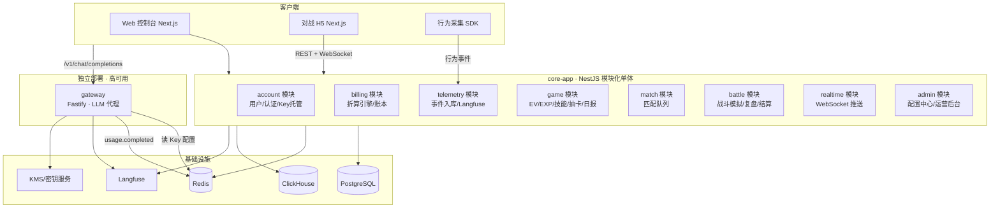
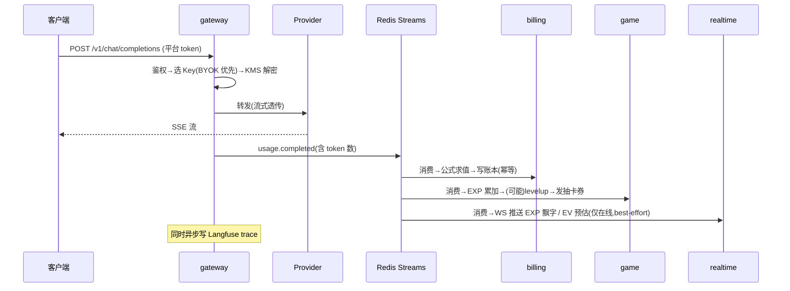
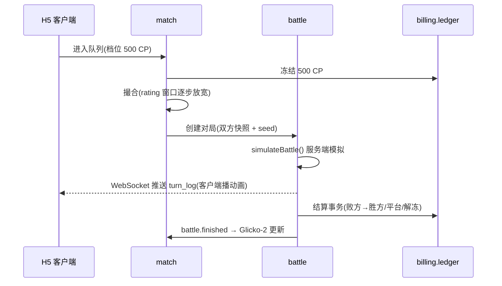

# DigMon 代码架构设计

> Architecture Design v0.1 · 配套文档:[技术设计](./tech-design.md) · [产品文档(H5)](./product.html)

---

## 1. 总体决策

| 决策点 | 选择 | 理由 |
|---|---|---|
| 架构形态 | **模块化单体(Modular Monolith)+ 独立网关** | 团队早期迭代快;网关有独立的性能/可用性要求必须拆出;其余模块以清晰边界写在一个进程里,未来按模块拆微服务零重构 |
| 语言 | **TypeScript 全栈** | 网关(Node 流式代理生态成熟)、游戏逻辑、前端共享类型;数值模拟部分纯函数化,性能瓶颈时可下沉 Rust |
| 框架 | NestJS(app 服务)+ Fastify(网关)+ Next.js(Web/H5) | NestJS 模块系统天然匹配模块化单体 |
| 数据库 | PostgreSQL(业务/账本)+ Redis(队列/缓存)+ ClickHouse(事件/特征) | 账本要事务;事件量大要列存 |
| 事件总线 | Redis Streams(起步)→ Kafka(规模化) | 抽象 `EventBus` 接口,平滑迁移 |
| LLM 可观测 | Langfuse self-host | 见技术文档 §4 |
| Monorepo | pnpm workspace + Turborepo | — |

## 2. 服务拓扑



**关键隔离原则**:网关只依赖 Redis(Key 路由缓存 + 事件写入)与 KMS,**core-app 整体宕机不影响 AI 代理主链路**。

## 3. Monorepo 目录结构

```
digmon/
├── apps/
│   ├── gateway/                    # LLM 网关(独立部署)
│   │   └── src/
│   │       ├── routes/             #   /v1/chat/completions, /v1/embeddings
│   │       ├── providers/          #   openai.ts / anthropic.ts / deepseek.ts 适配器
│   │       ├── router/             #   Key 选择、熔断、负载均衡
│   │       ├── crypto/             #   信封解密(KMS 客户端)
│   │       ├── usage/              #   token 统计、usage.completed 发布
│   │       └── tracing/            #   Langfuse sink
│   │
│   ├── core-app/                   # 模块化单体(NestJS)
│   │   └── src/
│   │       ├── modules/
│   │       │   ├── account/        #   用户、认证、API Key 托管(录入/校验/状态机)
│   │       │   ├── billing/        #   ├─ formula/   折算公式 DSL 引擎 + 版本管理
│   │       │   │                   #   ├─ ledger/    复式账本(冻结/结算/幂等)
│   │       │   │                   #   └─ pricing/   价格表同步
│   │       │   ├── telemetry/      #   事件消费、ClickHouse 写入、Langfuse 关联
│   │       │   ├── game/           #   ├─ ev/        特征→EV 引擎(权重矩阵可配)
│   │       │   │                   #   ├─ exp/       EXP 结算、等级曲线
│   │       │   │                   #   ├─ skill/     技能仓库、装备
│   │       │   │                   #   ├─ gacha/     抽卡、保底、审计随机数
│   │       │   │                   #   └─ report/    EV 日报(归因分解 → 结构化数据)
│   │       │   ├── match/          #   匹配队列、Glicko-2、战力评估、反喂分
│   │       │   ├── battle/         #   ├─ engine/    确定性战斗模拟(纯函数)
│   │       │   │                   #   ├─ analysis/  复盘归因(turn_log → 败因/建议)
│   │       │   │                   #   ├─ room/      对战房间、演出推送
│   │       │   │                   #   └─ settle/    结算编排(调 billing)
│   │       │   ├── realtime/       #   统一 WebSocket:EXP 飘字、EV 预估、战斗演出、日报通知
│   │       │   └── admin/          #   配置中心 CRUD、灰度、审计日志
│   │       └── workers/            #   定时任务:EV 日结+日报生成、Key 巡检、结算补偿
│   │
│   └── web/                        # Next.js:控制台 + 对战 H5(App Router 分区)
│       └── src/app/                #   页面结构对齐产品文档「功能地图」五页面
│           ├── (console)/          #   控制台:Key 管理、账单(逐笔折算追溯)、用量报表
│           └── (game)/             #   训练师主页 / 抽卡&技能仓库 /
│                                   #   对战大厅(演出播放器+回放+复盘页)/ EV 日报
│
├── packages/
│   ├── shared/                     # 跨端共享类型:事件 schema、DTO、错误码
│   ├── battle-core/                # ★ 纯函数战斗引擎(零依赖,前后端同构,
│   │                               #    服务端模拟 + 客户端回放动画共用一套代码)
│   ├── formula-engine/             # ★ 折算公式 DSL 解析/求值/沙箱(billing 与 admin 预览共用)
│   ├── game-config/                # 数值配置 schema + 默认值(技能表/克制表/概率表)
│   └── tracking-sdk/               # 浏览器行为采集 SDK(prompt.edited 等事件)
│
├── infra/
│   ├── docker-compose.yml          # pg / redis / clickhouse / langfuse 本地一键起
│   └── migrations/                 # 数据库迁移(drizzle-kit / prisma migrate)
│
├── docs/                           # 本文档所在
├── turbo.json
└── pnpm-workspace.yaml
```

★ 标记的两个包是架构的关键抽象:**战斗引擎**与**公式引擎**都做成无副作用的纯函数库,天然可测试、可回放、可在前端复用。

## 4. 模块间契约

### 4.1 通信方式

- **同进程模块间**:只允许通过模块 public API(NestJS module exports)调用,禁止跨模块直接访问对方表;
- **跨进程(gateway ↔ core)**:只通过事件总线,无 RPC 依赖;
- **异步领域事件**(Redis Streams topic):

| Topic | 生产者 | 消费者 |
|---|---|---|
| `usage.completed` | gateway | billing / game.exp / telemetry / realtime(EXP 飘字) |
| `behavior.tracked` | tracking-sdk → telemetry | game.ev |
| `ev.settled`(日结) | game.ev worker | game(面板重算)/ game.report(生成日报) |
| `ev.report.generated` | game.report | realtime(日报通知) |
| `trainer.levelup` | game.exp | game.gacha(发券)/ realtime |
| `battle.finished` | battle.engine | battle.settle / battle.analysis / match(rating 更新) |
| `settlement.done` | billing.ledger | realtime / 排行榜 |

所有消费者以 `event_id` 幂等,消费位点独立,单个下游故障不影响其他下游。

### 4.2 核心数据模型(PostgreSQL)

```sql
-- 账户与 Key
users(id, email, tier, privacy_mode, created_at)
provider_keys(id, user_id, provider, encrypted_dek, ciphertext,
              model_whitelist jsonb, status, last_verified_at)

-- 账本(只增)
ledger_entries(id, event_id UNIQUE, user_id, account,          -- available|frozen|revenue
               delta_cp BIGINT, reason, ref_type, ref_id,       -- battle|usage|gacha|topup
               formula_version, snapshot jsonb, created_at)

-- 配置中心(公式/权重/概率共用)
config_versions(id, namespace,                                  -- credit_formula|ev_weights|gacha_rates|battle_params
                version, payload jsonb, status,                 -- draft|gray|active|retired
                gray_ratio, effective_at, created_by)

-- 游戏
trainers(id, user_id, species_id, level, exp BIGINT,
         ivs jsonb, evs jsonb,                                  -- {hp,atk,def,spa,spd,spe}
         rating REAL, rating_rd REAL, equipped_skills jsonb)
skills(id, name, type, category, power, accuracy, pp, rarity, effect jsonb)
trainer_skills(trainer_id, skill_id, obtained_at, source)
gacha_logs(id, user_id, draw_counter, seed_hmac, result_skill_id, rarity, created_at)

-- 对战
battles(id, trainer_a, trainer_b, stake_cp, seed BIGINT,
        snapshot_a jsonb, snapshot_b jsonb,                     -- 开战时属性/技能快照
        turn_log jsonb, winner, reason, settled_at)
```

ClickHouse 侧:`raw_events`(所有事件原样落库)、`feature_daily`(物化视图,按 trainer×day 聚合出 EV 特征)。

### 4.3 关键接口示意

```ts
// packages/battle-core —— 确定性战斗引擎
export function simulateBattle(input: {
  a: TrainerSnapshot; b: TrainerSnapshot;
  config: BattleConfig;        // 克制表、参数(来自配置中心)
  seed: number;
}): BattleResult;              // { turns: TurnEvent[], winner, reason }
// 同样的 input 永远返回同样的 BattleResult(内部用种子化 PRNG,如 mulberry32)

// packages/formula-engine —— 折算公式
export function evaluateCredit(
  expression: string,          // DSL 文本
  vars: Record<string, number> // tokens、price.*、fx_rate...
): { creditCost: number; trace: EvalTrace };  // trace 用于账单审计展示
```

## 5. 请求时序(两条主链路)

### 5.1 AI 调用链路



### 5.2 对战链路



## 6. 部署与环境

```
生产:
  gateway        × N   (无状态,水平扩,前置 LB)
  core-app       × 2   (API 面)
  core-worker    × 2   (Streams 消费者 + cron,与 API 同镜像不同入口)
  web            Vercel / 自托管
  PostgreSQL     主从 + PITR
  Redis          哨兵/Cluster
  ClickHouse     单机起步
  Langfuse       self-host(独立 pg)

本地:infra/docker-compose.yml 一键起全部依赖;pnpm dev 并行起三个 app。
```

## 7. 实施路线(供排期参考)

阶段划分对齐产品的三个子循环:M1 打底,M2 交付「使用循环 + 成长循环」,M3/M4 交付「对战循环」。

| 阶段 | 范围 | 里程碑(以循环闭合为验收) |
|---|---|---|
| M1(4 周) | gateway + account(Key 托管)+ billing(公式引擎 + 账本)+ 控制台 | 能托管 Key、代理调用、按可配置公式扣 CP |
| M2(3 周) | telemetry + Langfuse + game(EV/EXP/等级)+ realtime(EXP 飘字)+ EV 日报 | **使用循环、成长循环闭合**:调用有即时反馈,每日有日报与归因 |
| M3(3 周) | skill/gacha + battle-core 引擎 + 复盘归因 + PVE 试炼 | 升级抽卡、打 AI 队伍验证数值与复盘体验 |
| M4(3 周) | match + PVP + 质押结算 + 反作弊基线 | **对战循环闭合**:完整主循环上线内测 |
| M5(持续) | 赛季、排行榜、道具、运营后台深化 | 公测 |

产品明确的「刻意不做」清单(公会/社交、体力值、签到、Chat UI、装备强化)不进任何阶段排期,也不在代码中预留抽象。
