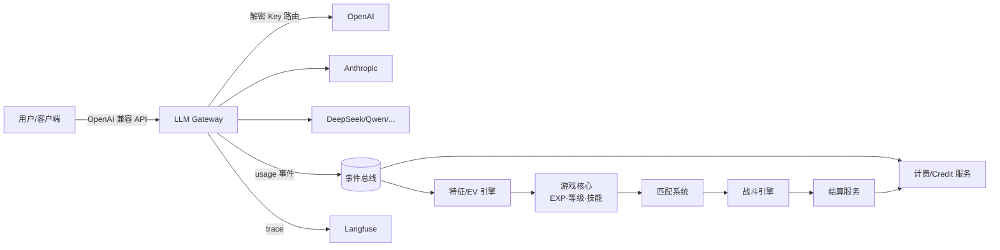

# DigMon 技术设计文档

> AI 模型聚合 + 训练师养成对战平台 · Technical Design v0.1
>
> 配套文档:[产品文档(H5)](./product.html) · [代码架构](./architecture.md)

---

## 目录

1. [系统总览](#1-系统总览)
2. [模型 Key 托管与统一网关](#2-模型-key-托管与统一网关)
3. [Credit Point 折算引擎(可配置公式)](#3-credit-point-折算引擎可配置公式)
4. [过程数据采集(Langfuse 集成)](#4-过程数据采集langfuse-集成)
5. [努力值(EV)映射引擎](#5-努力值ev映射引擎)
6. [经验值与升级系统](#6-经验值与升级系统)
7. [技能池与抽卡系统](#7-技能池与抽卡系统)
8. [匹配系统](#8-匹配系统)
9. [战斗系统](#9-战斗系统)
10. [赛后结算与经济系统](#10-赛后结算与经济系统)
11. [安全与反作弊](#11-安全与反作弊)
12. [非功能性需求](#12-非功能性需求)

---

## 1. 系统总览

### 1.1 一句话描述

用户把各家大模型(OpenAI / Anthropic / DeepSeek / Qwen / …)的 API Key 托管到平台,平台统一计价为 **Credit Point(CP)** 并代理所有 AI 调用;调用过程中的 prompt、token、行为数据被采集并映射为宝可梦式的**努力值(EV)六维属性**;token 消耗转化为**经验值(EXP)**驱动升级,升级触发**技能抽卡**;玩家之间通过**匹配系统**进入**回合制自动战斗**,败方按规则把一部分 CP 输给胜方。

### 1.2 核心数据流



### 1.3 域划分

| 域 | 职责 | 关键约束 |
|---|---|---|
| Gateway 域 | LLM 请求代理、Key 路由、限流、usage 上报 | 低延迟、高可用,与游戏域完全解耦 |
| Billing 域 | Key 托管、CP 折算、账本、冻结/结算 | 强一致(账本用事务 + 幂等) |
| Telemetry 域 | trace/事件采集、Langfuse、特征计算 | 最终一致,允许分钟级延迟 |
| Game 域 | EV、EXP、等级、技能、抽卡 | 规则可配置、可回放 |
| Battle 域 | 匹配、战斗模拟、结算触发 | 服务端权威、确定性可复盘 |

---

## 2. 模型 Key 托管与统一网关

### 2.1 Key 托管

- 用户在控制台录入 Provider Key,附带:provider、可用模型白名单、月度用量上限(可选)。
- **加密存储**:信封加密(Envelope Encryption)。每条 Key 用随机 DEK(AES-256-GCM)加密,DEK 再由 KMS 主密钥(或自建 HSM / age 密钥)加密。数据库永不落明文。
- **录入即校验**:异步任务调用 provider 的低成本探测接口(如 `GET /models`)验证有效性;定期(每 6h)健康巡检,失效的 Key 打标并通知用户。
- Key 状态机:`pending_verify → active → throttled → invalid → revoked`。

### 2.2 统一网关(OpenAI 兼容)

- 对外暴露 `POST /v1/chat/completions`(以及 `/v1/embeddings` 等),入参兼容 OpenAI 协议,模型名采用 `provider/model` 形式(如 `anthropic/claude-sonnet-4`)。
- 路由策略(按优先级):
  1. 用户自己托管的、匹配该模型的 Key(**BYOK 模式**,只收平台服务费);
  2. 平台自营 Key 池(**CP 直购模式**,按折算价扣 CP)。
- 流式(SSE)透传;usage 在流结束时汇总上报。provider 不返回 usage 时,用 tokenizer(tiktoken / provider 对应分词器)本地估算并打上 `estimated` 标记。
- 失败重试与熔断:同模型多 Key 轮询,单 Key 连续 5xx / 429 进入半开熔断。

### 2.3 usage 事件(网关唯一出口)

```jsonc
// topic: usage.completed
{
  "event_id": "uuid",            // 幂等键
  "user_id": "u_123",
  "trainer_id": "t_456",         // 游戏侧角色
  "request_id": "req_789",
  "provider": "anthropic",
  "model": "claude-sonnet-4",
  "key_source": "byok | platform",
  "input_tokens": 1234,
  "output_tokens": 567,
  "cached_tokens": 0,
  "latency_ms": 2100,
  "status": "ok | error | timeout",
  "langfuse_trace_id": "...",
  "ts": "2026-07-25T08:00:00Z"
}
```

计费、EXP、EV 三个下游各自消费该事件,互不阻塞。

---

## 3. Credit Point 折算引擎(可配置公式)

### 3.1 设计目标

- 不同 provider / model / token 类型的成本,统一折算成平台货币 **CP**;
- 折算**公式本身可配置**(不只是改参数,还能改公式结构),支持灰度、版本化、审计;
- 每笔账可追溯到"当时生效的公式版本 + 输入变量"。

### 3.2 三层配置模型

```
Layer 1  价格表 PriceTable      —— provider/model 的原始单价(USD / 1M tokens),随官方价更新
Layer 2  折算公式 Formula(DSL)  —— USD 成本 → CP 的表达式,可配置可热更
Layer 3  策略覆盖 PolicyOverride —— 按用户等级/活动/BYOK 等维度的系数覆盖
```

### 3.3 公式 DSL

采用安全表达式引擎(推荐 [expr-eval](https://github.com/silentmatt/expr-eval) / [CEL](https://github.com/google/cel-spec),禁止任意代码执行),内置变量与函数:

```text
# 默认公式示例(formula version: v3)
usd_cost   = input_tokens / 1e6 * price.input
           + output_tokens / 1e6 * price.output
           + cached_tokens / 1e6 * price.cached

credit     = ceil( usd_cost * fx_rate * margin * tier_discount )

# 内置变量:
#   input_tokens / output_tokens / cached_tokens
#   price.*        —— Layer1 注入
#   fx_rate        —— USD→CP 锚定汇率,如 1 USD = 1000 CP
#   margin         —— 平台系数,如 1.15(BYOK 模式则为 0.05 纯服务费)
#   tier_discount  —— Layer3 注入,如大客户 0.9
# 内置函数: ceil/floor/round/min/max/clamp/if
```

### 3.4 版本化与生效

```sql
CREATE TABLE credit_formula (
  id            BIGSERIAL PRIMARY KEY,
  version       TEXT NOT NULL,          -- v3
  scope         TEXT NOT NULL,          -- global | provider:openai | model:openai/gpt-5
  expression    TEXT NOT NULL,          -- DSL 文本
  variables     JSONB NOT NULL,         -- 默认变量值
  status        TEXT NOT NULL,          -- draft / gray / active / retired
  effective_at  TIMESTAMPTZ NOT NULL,
  created_by    TEXT NOT NULL
);
```

- 匹配优先级:`model 级 > provider 级 > global`;
- 变更流程:draft → 沙箱回放最近 7 天账单做 diff 预览 → gray(按用户百分比)→ active;
- 每笔扣费记录 `formula_version` + 变量快照,可完整审计重算。

### 3.5 账本

复式记账,`ledger_entry` 只增不改;余额为聚合视图 + 缓存。所有扣费以 `event_id` 幂等。战斗质押走 `frozen` 子账户(见 [§10](#10-赛后结算与经济系统))。

---

## 4. 过程数据采集(Langfuse 集成)

### 4.1 选型

| 方案 | 结论 |
|---|---|
| **Langfuse(self-host)** | ✅ 主选。开源、LLM 原生(trace/generation/score)、有 Python/TS SDK、支持 prompt 管理与评分 |
| OpenTelemetry + ClickHouse | ✅ 并行保留。行为事件(非 LLM 调用)走自建事件管道进 ClickHouse |
| Helicone / Phoenix | 备选,接口层已抽象为 `TelemetrySink`,可替换 |

原则:**Langfuse 存 LLM 语义数据(prompt/completion/trace),自建管道存行为与游戏特征数据**,两边用 `trace_id` 关联。

### 4.2 采集清单

**LLM 调用类(网关自动采集 → Langfuse generation):**

- prompt / completion 全文(用户可在隐私设置中选择「仅存脱敏摘要」)
- 模型、参数(temperature 等)、token 数、延迟、错误
- 会话上下文:session_id、轮次、是否携带 system prompt / tools

**用户行为类(客户端 SDK / 控制台埋点 → 事件管道):**

| 事件 | 含义 | 喂给哪个 EV |
|---|---|---|
| `prompt.edited` | 发送前反复修改 prompt | 特防(审慎) |
| `response.regenerated` | 重新生成 | 防御 |
| `response.copied` / `accepted` | 采纳输出 | 攻击(一击命中) |
| `session.duration` | 会话时长/深夜使用 | HP |
| `tool.called` | function calling / 多模态 | 特攻 |
| `rapid.fire` | 高频短 prompt | 速度 |

### 4.3 隐私与合规

- prompt 明文存储默认开启、可关闭;关闭时只保留 hash + 统计特征(长度、语言、是否含代码块等),**EV 计算仅依赖统计特征,不依赖明文**,保证隐私模式下游戏体验一致。
- PII 脱敏:入库前经规则 + 小模型清洗(邮箱/手机号/密钥模式)。
- 数据保留:明文 30 天滚动删除,统计特征长期保留。

---

## 5. 努力值(EV)映射引擎

### 5.1 六维定义

沿用宝可梦六维,映射「AI 使用风格」:

| 属性 | 含义 | 主要特征信号 |
|---|---|---|
| **HP 体力** | 使用粘性与持久度 | 活跃天数、日均会话时长、连续使用 streak |
| **攻击 Atk** | 直接高效的指令风格 | 一次采纳率、短指令产出比、代码生成占比 |
| **防御 Def** | 容错与纠错能力 | 重试后成功率、错误恢复速度、prompt 中的约束条款密度 |
| **特攻 SpA** | 创造性与复杂任务 | prompt 复杂度(长度/结构)、创意类任务占比、工具与多模态使用 |
| **特防 SpD** | 对 AI 输出的批判性 | 输出编辑率、拒绝/追问率、幻觉纠正行为 |
| **速度 Spe** | 交互节奏 | 请求间隔中位数、短平快任务占比、并发会话数 |

### 5.2 计算管道

```
原始事件 (usage.completed + 行为事件)
  → 特征提取 (小时级批处理, ClickHouse 物化视图)
  → 归一化 (对全体玩家分布取分位数, winsorize 1%~99%)
  → EV 增量 Δev[i] = Σ w[i][j] · feature_norm[j] · daily_cap
  → 结算入库 (每日 00:00 UTC+8)
```

- **权重矩阵 `w` 是运营可配置的**(与折算公式同一套版本化机制);
- 宝可梦式约束:单项 EV 上限 **252**,六维总和上限 **510**;达到上限后溢出转化为少量 EXP;
- **周衰减**:每周日对全部 EV 乘 0.98,防止老玩家永久碾压,同时鼓励持续使用;
- 玩家可用道具「营养饮料」(CP 购买)定向 +10 某维,单项道具加成上限 100(与宝可梦一致的手感)。

### 5.3 从 EV 到面板属性

```
stat[i] = floor( (2·base[i] + iv[i] + ev[i]/4) · level / 100 ) + 5     (非 HP)
hp      = floor( (2·base_hp + iv_hp + ev_hp/4) · level / 100 ) + level + 10
```

- `base[i]`:训练师选择的「数码兽种族」决定的种族值(产品侧提供若干初始种族);
- `iv[i]`:注册时随机 0~31(个体值),制造个体差异;
- 完全复用宝可梦三代+公式,平衡性数据可直接参考成熟数值体系。

---

## 6. 经验值与升级系统

### 6.1 token → EXP

```
exp_gain = floor( k · (input_tokens · 0.3 + output_tokens · 1.0)^0.9 )
```

- 输出 token 权重更高(代表真实产出);指数 0.9 做次线性压制,防止氪 token 无脑冲级;
- `k` 可配置(默认 0.05),活动期间可乘加成;
- **单日 EXP 上限**(默认 50,000),超出部分折半,反刷量。

### 6.2 等级曲线

采用宝可梦「中速经验组」:`total_exp(L) = L³`,满级 100。升级所需 EXP 随等级立方增长,前期升级快(留存钩子)、后期慢(付费/活跃深水区)。

### 6.3 升级奖励

- 每次升级 → 获得 **1 次技能抽卡券**;
- 每 10 级 → 额外一次「十连」;
- 升级时按公式重算面板属性(见 §5.3)。

---

## 7. 技能池与抽卡系统

### 7.1 技能模型

```jsonc
{
  "skill_id": "sk_flame_prompt",
  "name": "烈焰咏唱",
  "type": "fire",              // 属性,参与克制表
  "category": "special",       // physical / special / status
  "power": 90,
  "accuracy": 0.95,
  "pp": 10,
  "rarity": "SR",              // N / R / SR / UR
  "effect": {                   // 可选特效,DSL 描述
    "burn_chance": 0.1
  }
}
```

- 技能属性(type)与 EV 风格呼应:如「代码系」「创意系」「审查系」,克制表由策划配置;
- 每个训练师**最多装备 4 个技能**(宝可梦手感),其余进技能仓库,可替换、可分解为「技能碎片」合成保底。

### 7.2 抽卡(Gacha)

| 稀有度 | 基础概率 | 保底 |
|---|---|---|
| UR | 1% | 80 抽硬保底,50 抽后概率每抽 +0.5%(软保底) |
| SR | 9% | 10 连必出 ≥SR |
| R | 30% | — |
| N | 60% | — |

- 概率表可配置、**必须公示**(合规);
- 抽卡随机数:服务端 `seed = HMAC(server_secret, user_id + draw_counter)`,可审计不可预测;
- 重复技能自动转碎片。抽卡券主要来自升级,少量来自活动;**不直接卖抽卡券**(避免纯赌博定性),CP 只能买「营养饮料」等养成道具。

---

## 8. 匹配系统

### 8.1 评分与分段

- 内部评分用 **Glicko-2**(比 ELO 多不确定度 RD,适合低频对战玩家);
- 对外展示段位:学徒 → 训练家 → 精英 → 道馆主 → 冠军(按赛季 rating 分位数划定)。

### 8.2 匹配流程

```
进入队列(选定质押档位: 100 / 500 / 2000 CP)
  → 冻结质押 CP(账本 frozen)
  → 候选池筛选: |rating差| < 100 + 15·等待秒数 (逐步放宽)
                且同一质押档位
                且综合战力差 < 阈值(战力 = f(等级, EV总和, 技能评分))
  → 撮合成功 → 创建 battle_room → 进入战斗
  → 90 秒无人 → 匹配 AI 幽灵队伍(用真实玩家快照,质押减半)
```

- Redis Sorted Set 按 rating 存队列,匹配器每 2s 扫描撮合;
- 反匹配作弊:同 IP / 同设备指纹 / 近期高频互战的两人禁止撮合(防喂分)。

### 8.3 战力评估

`power_score = 0.4·level_norm + 0.35·ev_total_norm + 0.25·skill_score_norm`,用于避免"等级高但裸装"和"低级神装"造成体验崩坏。

## 9. 战斗系统

### 9.1 形态:服务端权威 + 确定性回放

- 回合制**自动战斗**(玩家赛前配置技能与策略倾向,战斗本身无操作,适合 H5 短平快);
- 战斗模拟完全在服务端执行,输入为「双方快照 + 随机种子」,输出为「逐回合事件日志」;
- **同样输入必然产生同样结果** → 客户端只做动画播放,争议可复盘,回放 = 重新模拟。

### 9.2 回合流程

```
每回合:
  1. 双方按策略倾向选择技能(激进/均衡/保守 → 不同技能权重)
  2. 速度(Spe)高者先手;同速掷硬币
  3. 命中判定 → 伤害计算 → 特效结算(灼烧/麻痹/增益)
  4. 任一方 HP≤0 → 结束;30 回合未分胜负 → 剩余 HP 百分比高者胜
```

### 9.3 伤害公式(仿宝可梦)

```
damage = floor( ( (2·level/5 + 2) · power · A/D ) / 50 + 2 )
         · STAB · type_mult · crit · random(0.85~1.00)

A/D    : 物理技能用 Atk/Def,特殊技能用 SpA/SpD
STAB   : 技能属性与训练师主属性一致时 ×1.5
type_mult : 克制表 0 / 0.5 / 1 / 2
crit   : 1/16 概率 ×1.5
```

### 9.4 战斗事件日志

```jsonc
{ "battle_id": "b_1", "seed": 928123,
  "turns": [
    { "t": 1, "actor": "t_456", "skill": "sk_flame_prompt",
      "hit": true, "crit": false, "damage": 42, "hp_after": [158, 120] }
  ],
  "winner": "t_456", "reason": "ko" }
```

---

## 10. 赛后结算与经济系统

### 10.1 结算规则

```
败方损失 = stake · loss_rate        (默认 loss_rate = 30%)
平台抽成 = 败方损失 · rake          (默认 rake = 10%)
胜方所得 = 败方损失 - 平台抽成
双方解冻剩余质押
```

- `loss_rate` / `rake` 均为可配置参数,与折算公式同一配置中心;
- 平局:双方各扣 2% 作为「场地费」,其余解冻;
- 系统幽灵队伍对局:胜利奖励由平台奖池出,减半。

### 10.2 账本流转(复式)

```
匹配成功:  user.available → user.frozen            (双方, 各 stake)
结算(胜): loser.frozen → winner.available          (损失-抽成)
           loser.frozen → platform.revenue          (抽成)
           loser.frozen → loser.available           (剩余)
           winner.frozen → winner.available         (全额解冻)
```

所有结算在单事务内完成,以 `battle_id` 幂等;战斗服务崩溃有 10 分钟超时补偿任务,超时未结算自动全额解冻。

### 10.3 经济闸门

- 每日对战输掉的 CP 总额有上限(默认账户余额的 20%),防止一夜清零的恶性体验;
- 新手保护:前 10 场败方损失减免 50%;
- CP 只能消费不能提现(合规红线),BYOK 用户的质押只能用「平台服务费充值的 CP」。

---

## 11. 安全与反作弊

| 风险 | 对策 |
|---|---|
| Key 泄露 | 信封加密 + KMS;网关内存中解密、用完即弃;审计日志 |
| 刷 token 冲级 | EXP 次线性 + 单日上限;同 prompt 高相似度重复请求打折(SimHash 检测) |
| 喂分(小号送 CP) | 同设备/IP/资金图谱检测;新账号胜场收益衰减;Glicko-2 RD 异常告警 |
| 折算公式配置事故 | 沙箱回放 diff + 灰度 + 一键回滚;单笔扣费金额熔断阈值 |
| prompt 注入采集系统 | 采集侧只做统计与存储,不将用户内容送入任何有权限的执行环境 |
| 抽卡概率争议 | 概率公示 + 服务端可审计随机数(HMAC 种子) |

---

## 12. 非功能性需求

- **网关延迟**:代理开销 P99 < 80ms(不含上游模型耗时);
- **可用性**:网关 99.9%;游戏域 99.5%(游戏故障不得影响网关代理主链路——事件总线削峰解耦);
- **一致性**:账本强一致;EV/EXP 最终一致(日结);
- **可配置项全景**:折算公式、EV 权重矩阵、EXP 系数、技能数值、抽卡概率、克制表、loss_rate/rake —— 全部走同一配置中心,版本化 + 灰度 + 审计;
- **可回放**:战斗(种子重放)、账单(公式版本重算)、EV(特征快照重算)三者均可完整复现。
