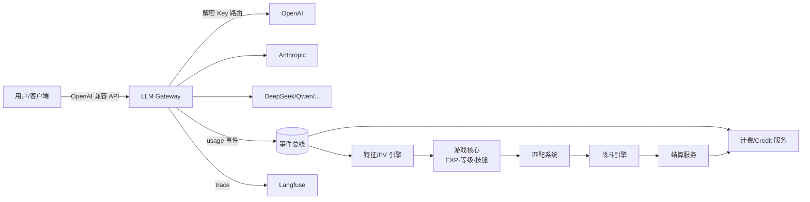

# Mogwai 技术设计文档

> AI 模型聚合 + 训练师养成对战平台 · Technical Design v0.3
>
> 配套文档:[产品文档(H5)](./product.html) · [代码架构](./architecture.md)

---

## 目录

1. [系统总览](#1-系统总览)
2. [模型 Key 托管与统一网关](#2-模型-key-托管与统一网关)
3. [Credit Point 折算引擎(可配置公式)](#3-credit-point-折算引擎可配置公式)
4. [过程数据采集(Langfuse 集成)](#4-过程数据采集langfuse-集成)
5. [努力值(EV)映射引擎](#5-努力值ev映射引擎)
6. [经验值与升级系统](#6-经验值与升级系统)
7. [技能池与抽卡系统](#7-技能池与抽卡系统)
8. [匹配系统](#8-匹配系统)
9. [战斗系统](#9-战斗系统)
10. [赛后结算与经济系统](#10-赛后结算与经济系统)
11. [安全与反作弊](#11-安全与反作弊)
12. [非功能性需求](#12-非功能性需求)

---

## 1. 系统总览

### 1.1 一句话描述

用户把各家大模型(OpenAI / Anthropic / DeepSeek / Qwen / 火山方舟 / …)的 API Key 托管到平台,平台统一计价为 **Credit Point(CP)** 并代理所有 AI 调用;调用过程中的 prompt、token、行为数据被采集并映射为宝可梦式的**努力值(EV)六维属性**;token 消耗转化为**经验值(EXP)**驱动升级,升级触发**技能抽卡**;玩家之间通过**匹配系统**进入**回合制自动战斗**,败方在账本上背负对胜方的 CP 债务,以自己托管的 Key 为胜方承担等值 token 消耗来清偿——**平台全程只记账,不托管、不抽取任何用户资产**。

### 1.2 核心数据流



### 1.3 域划分

| 域 | 职责 | 关键约束 |
|---|---|---|
| Gateway 域 | LLM 请求代理、Key 路由、限流、usage 上报 | 低延迟、高可用,与游戏域完全解耦 |
| Billing 域 | Key 托管、CP 折算、账本、冻结/结算 | 强一致(账本用事务 + 幂等) |
| Telemetry 域 | trace/事件采集、Langfuse、特征计算 | 最终一致,允许分钟级延迟 |
| Game 域 | EV、EXP、等级、技能、抽卡 | 规则可配置、可回放 |
| Battle 域 | 匹配、战斗模拟、结算触发 | 服务端权威、确定性可复盘 |

### 1.4 产品原则带来的技术约束

产品文档确立的设计原则「**游戏是工作的副产品**」,直接转化为四条硬性技术约束:

1. **零额外操作**:所有养成数据必须由网关与 SDK 自动采集,不允许任何需要用户主动"喂养"的接口设计;
2. **分钟级反馈**:每次 `usage.completed` 必须在秒级推送到在线客户端(EXP 飘字 / EV 预估增量),见 §2.4;
3. **可归因**:EV 的每一点变动必须能回溯到具体行为特征,支撑「EV 日报」的归因文案(如"重试后修复 12 次错误 → 防御 +4"),见 §5.4;
4. **可复盘**:战斗结果必须附带败因分析数据,复盘页是把玩家引导回养成循环的关键入口,见 §9.5。
5. **采集钉在网关,客户端形态可替换**(2026-07-25 裁定):平台的立身之本是拿到用户数据与提示词,因此语义数据采集必须在网关层完成,不得依赖任何特定客户端;客户端形态(当前:第三方网关 + 控制台;未来可能:纯 CLI addon)是可替换外壳,替换外壳不得影响数据回流。
   - **目标用户与可达边界**(2026-07-25 讨论结论):目标画像是「按 token 付费的 coding agent 用户」——Claude Code / Codex CLI / Cline / Cursor / Trae 等工具均支持 base URL 覆盖,一行配置即接入网关(OpenRouter 已验证此路径,coding agent 是网关类产品最大流量源)。订阅制流量(Claude Max OAuth、Cursor 内置模型)走厂商私有鉴权,结构性不可达,不为其改设计;订阅用户定位为转化漏斗上游——EV/EXP 只从网关流量生长,游戏机制本身构成把流量迁移过来的动力。
   - **数据面分级**:网关采集是**权威数据面**(计费、正式 EV/EXP、结算全部只认它);未来 addon 侧采集(本地工件读取等,见 journal/TODO 长线)是**低信任辅助面**——客户端数据均为用户自述、可伪造,只进练习赛与成长展示,永不进入正式数值与经济(信任边界见 §4.2)。

同时,产品明确**首版不做**:公会/社交、体力值、每日签到、Chat UI、装备强化——技术方案不为这些预留抽象,需要时再重构。

### 1.5 合约化原则(Contract Pinning)

所有**有经济后果的执行**,在发起时刻绑定一份不可变的「合约」= 规则版本 + 参数快照。类比智能合约:一经创建,双方与平台都只能按合约条款执行与仲裁;后续任何配置变更都不影响已发起的执行。

| 执行 | 合约内容 | 固化位置 |
|---|---|---|
| 计费扣款 | 折算公式版本 + 变量快照 | `ledger_entries.formula_version / snapshot` |
| 抽卡 | 概率表版本 + 审计种子 | `gacha_logs.rates_version / seed_hmac` |
| 对战与结算 | 质押额、loss_rate、战斗参数版本、双方快照、种子、新手保护标记 | `battles.contract`(JSONB) |

由此,**配置中心(可变,面向未来的执行)与合约(不可变,面向单次执行)彻底解耦**:主干流程与仲裁只读合约,不回读配置中心;回放与审计只需要合约本身。

---

## 2. 模型 Key 托管与统一网关

### 2.1 Key 托管

- 用户在控制台录入 Provider Key,附带:provider、可用模型白名单、月度用量上限(可选)。
- **加密存储**:信封加密(Envelope Encryption)。每条 Key 用随机 DEK(AES-256-GCM)加密,DEK 再由 KMS 主密钥(或自建 HSM / age 密钥)加密。数据库永不落明文。
- **录入即校验**:异步任务调用 provider 的低成本探测接口(如 `GET /models`)验证有效性;定期(每 6h)健康巡检,失效的 Key 打标并通知用户。
- Key 状态机:`pending_verify → active → throttled → invalid → revoked`。

### 2.2 统一网关(OpenAI 兼容)

> 网关运行时选型为 LiteLLM Proxy(自托管)+ 自研薄插件,且被定义为可替换组件,详见架构文档 Part A。本节只描述与运行时无关的行为契约。

- 对外暴露**两种 wire format**(均为 M1 验收项):
  - `POST /v1/chat/completions`(以及 `/v1/embeddings` 等),入参兼容 OpenAI 协议,模型名采用 `provider/model` 形式(如 `anthropic/claude-sonnet-4`)——覆盖 Codex CLI / Cline / Cursor / Trae 等 OpenAI 兼容客户端;
  - `POST /v1/messages`(Anthropic wire format)——**硬需求**:Claude Code 通过 `ANTHROPIC_BASE_URL` 接入,是单一最大 coding agent 客户端,缺此端点等于放弃该人群(LiteLLM 原生支持,配置量级)。
- 接入形态即转化面:每工具的「一行配置」接入指南(工具选择 → 生成配置片段)是控制台一等公民,随 M1 控制台交付。
- 路由策略(按优先级):
  1. **债务清偿路由**:调用者存在未清偿债权时,优先使用债务人的托管 Key(见 §10.3);
  2. 用户自己托管的、匹配该模型的 Key(**BYOK 模式**,服务费记入平台应收);
  3. 平台自营 Key 池(**CP 直购模式**)——依赖充值,与支付一同启用(M4 后),**首发纯 BYOK**。
- 流式(SSE)透传;usage 在流结束时汇总上报。provider 不返回 usage 时,用 tokenizer(tiktoken / provider 对应分词器)本地估算并打上 `estimated` 标记。
- 失败重试与熔断:同模型多 Key 轮询,单 Key 连续 5xx / 429 进入半开熔断。

### 2.3 usage 事件(网关唯一出口)

```jsonc
// topic: usage.completed
{
  "schema_version": 1,           // 所有事件必带,消费者向后兼容一版
  "event_id": "uuid",            // 幂等键
  "user_id": "u_123",            // 只含账户概念;user→trainer 映射由 game 域自己维护,
                                 // 网关不知晓任何游戏概念
  "request_id": "req_789",
  "provider": "anthropic",
  "model": "claude-sonnet-4",
  "key_source": "byok | platform",
  "input_tokens": 1234,
  "output_tokens": 567,
  "cached_tokens": 0,
  "latency_ms": 2100,
  "status": "ok | error | timeout",
  "langfuse_trace_id": "...",
  "ts": "2026-07-25T08:00:00Z"
}
```

计费、EXP、EV、实时反馈四个下游各自消费该事件,互不阻塞。

**可靠性(该事件是计费唯一来源,不允许静默丢失):**

- usage_publisher 发布失败时写本地 spool 文件循环重投,Redis 恢复后按 `event_id` 幂等去重;
- Redis 开启 AOF(everysec);Streams 的 maxlen 裁剪必须确认四个消费组位点均已越过;
- **每日对账**:BullMQ 任务比对 LiteLLM spend log ↔ ledger,差异生成补记账目并告警(LiteLLM 的 spend 数据仅用于对账,不作权威计费)。

### 2.4 实时反馈通道(使用循环的钩子)

支撑产品「分钟级使用循环」:让每次日常调用都有轻量的可见奖励。

- core-app 的 realtime 模块消费 `usage.completed`,对在线的 WebSocket 会话推送:

```jsonc
// ws message: feedback.exp
{ "exp_gain": 37, "level_progress": 0.62,
  "ev_hint": { "atk": "+0.4 (预估)" } }   // EV 为预估值,以每日结算为准
```

- 推送是 best-effort:用户不在线直接丢弃,不落库不重试(日结数据才是权威);
- EV 预估用轻量启发式(仅基于本次调用的 token 结构),与每日的完整特征结算允许有偏差,客户端明确标注"预估"。

### 2.5 授权与清偿投影(事后计费的守门员)

事后计费模型必须回答:凭什么拒绝一个不该调用的用户?在不违反「网关不碰业务」铁律的前提下:

- billing 维护**授权投影**(第三个 Redis 投影,见架构文档 A4):「user → 服务费欠费、担保额度、未清偿债权/债务、拒绝标记」,账本变动后异步刷新;
- platform_auth 插件鉴权时**软性预检**:服务费欠费越限 → 拒绝(HTTP 402);CP 直购模式(M4 后)余额 ≤ 0 → 拒绝;
- key_resolver 读同一投影完成**债务清偿路由**(§10.3);
- 投影是近似值(异步更新),允许并发窗口内小幅越限,事后由权威账本追平;越限超过熔断阈值时 billing 主动下发拒绝标记;
- 网关侧只做数值比较与标记判断,**不做任何计算,业务规则全部留在 billing**。

---

## 3. Credit Point 折算引擎(可配置公式)

### 3.1 设计目标

- 不同 provider / model / token 类型的成本,统一折算成平台货币 **CP**;
- 折算**公式本身可配置**(不只是改参数,还能改公式结构),支持灰度、版本化、审计;
- 每笔账可追溯到"当时生效的公式版本 + 输入变量"。

### 3.2 三层配置模型

```
Layer 1  价格表 PriceTable      —— provider/model 的原始单价(USD / 1M tokens),随官方价更新
Layer 2  折算公式 Formula(DSL)  —— USD 成本 → CP 的表达式,可配置可热更
Layer 3  策略覆盖 PolicyOverride —— 按用户等级/活动/BYOK 等维度的系数覆盖
```

### 3.3 公式 DSL

采用安全表达式引擎(推荐 [expr-eval](https://github.com/silentmatt/expr-eval) / [CEL](https://github.com/google/cel-spec),禁止任意代码执行),内置变量与函数:

```text
# 默认公式示例(formula version: v3)
usd_cost   = input_tokens / 1e6 * price.input
           + output_tokens / 1e6 * price.output
           + cached_tokens / 1e6 * price.cached

credit     = ceil( usd_cost * fx_rate * margin * tier_discount )

# 内置变量:
#   input_tokens / output_tokens / cached_tokens
#   price.*        —— Layer1 注入
#   fx_rate        —— USD→CP 锚定汇率,如 1 USD = 1000 CP
#   margin         —— 平台系数,如 1.15(BYOK 模式则为 0.05 纯服务费)
#   tier_discount  —— Layer3 注入,如大客户 0.9
# 内置函数: ceil/floor/round/min/max/clamp/if
#
# 扩展性: 多模态计价维度(image_tokens / audio_seconds 等)
#   只需在 Layer1 价格表加维度 + 注入同名变量,公式结构不变
```

### 3.4 版本化与生效

```sql
CREATE TABLE credit_formula (
  id            BIGSERIAL PRIMARY KEY,
  version       TEXT NOT NULL,          -- v3
  scope         TEXT NOT NULL,          -- global | provider:openai | model:openai/gpt-5
  expression    TEXT NOT NULL,          -- DSL 文本
  variables     JSONB NOT NULL,         -- 默认变量值
  status        TEXT NOT NULL,          -- draft / gray / active / retired
  effective_at  TIMESTAMPTZ NOT NULL,
  created_by    TEXT NOT NULL
);
```

- 匹配优先级:`model 级 > provider 级 > global`;
- 变更流程:draft → 沙箱回放最近 7 天账单做 diff 预览 → gray(按用户百分比)→ active;
- 每笔扣费记录 `formula_version` + 变量快照,可完整审计重算。

### 3.5 账本(纯记账制,平台零托管)

**CP 是记账单位,不是托管货币**——平台不持有、不没收、不抽取任何用户资产,只负责记账与清偿路由(合规基石:平台是撮合与记账方,不是赌局参与方,收入只来自服务费,与输赢无关)。

- 复式记账,`ledger_entry` 只增不改,所有记账以 `event_id` 幂等;
- 账本上的科目是**关系**而非资金:`pledge_locked`(对战担保锁定)、`debt`(用户↔用户的债权债务)、`service_receivable`(平台服务费应收);
- 战斗质押 = 锁定担保额度;败方损失 = 记一笔对胜方的债务;清偿机制见 [§10](#10-赛后结算与经济系统)。

---

## 4. 过程数据采集(Langfuse 集成)

### 4.1 选型

| 方案 | 结论 |
|---|---|
| **Langfuse(self-host)** | ✅ 主选。开源、LLM 原生(trace/generation/score)、有 Python/TS SDK、支持 prompt 管理与评分 |
| OpenTelemetry + ClickHouse | ✅ 并行保留。行为事件(非 LLM 调用)走自建事件管道进 ClickHouse |
| Helicone / Phoenix | 备选,接口层已抽象为 `TelemetrySink`,可替换 |

原则:**Langfuse 存 LLM 语义数据(prompt/completion/trace),自建管道存行为与游戏特征数据**,两边用 `trace_id` 关联。

### 4.2 采集清单

**LLM 调用类(网关自动采集 → Langfuse generation):**

- prompt / completion 全文(用户可在隐私设置中选择「仅存脱敏摘要」)
- 模型、参数(temperature 等)、token 数、延迟、错误
- 会话上下文:session_id、轮次、是否携带 system prompt / tools

**用户行为类(客户端 SDK / 控制台埋点 → 事件管道):**

> **数据源主次(2026-07-25 修订)**:主力用户经 coding agent 接入网关,**不运行浏览器 tracking-sdk**——下表行为事件实际只覆盖 Web 控制台场景,是补充数据源。M2 设计 EV 特征清单时,**以网关流量可见特征为主数据源**:重新生成表现为相邻高相似请求、会话节奏与深度、工具调用模式、上下文长度分布等,均可从 `usage.completed` + Langfuse trace 在 ClickHouse 侧提取,且天然自带锚点、不可伪造。

| 事件 | 含义 | 喂给哪个 EV |
|---|---|---|
| `prompt.edited` | 发送前反复修改 prompt | 特防(审慎) |
| `response.regenerated` | 重新生成 | 防御 |
| `response.copied` / `accepted` | 采纳输出 | 攻击(一击命中) |
| `session.duration` | 会话时长/深夜使用 | HP |
| `tool.called` | function calling / 多模态 | 特攻 |
| `rapid.fire` | 高频短 prompt | 速度 |

**行为事件的信任边界(防刷 EV):**

行为事件来自浏览器、可被伪造,而 EV 影响战斗面板、战斗输赢是真实 CP——必须视为不可信输入:

- 行为事件必须携带**锚点**:关联一次真实调用的 `request_id`(或 `langfuse_trace_id`),telemetry 消费时与网关的 `usage.completed` 交叉核验;无锚点或核验失败的事件只进分析库,**不进 EV 特征**;
- 事件 API 按用户限流;按「行为事件数 / usage 调用数」比值做离群检测,异常账户 EV 冻结并告警。

### 4.3 隐私与合规

- prompt 明文存储默认开启、可关闭;关闭时只保留 hash + 统计特征(长度、语言、是否含代码块等),**EV 计算仅依赖统计特征,不依赖明文**,保证隐私模式下游戏体验一致。
- **隐私模式的执行点在网关**:平台 token 投影携带 `privacy_mode` 标志,LiteLLM 的 Langfuse callback 按标志只写脱敏摘要——明文根本不出网关,而不是入库后再删。
- PII 脱敏:入库前经规则 + 小模型清洗(邮箱/手机号/密钥模式)。
- 数据保留:明文 30 天滚动删除,统计特征长期保留。

---

## 5. 努力值(EV)映射引擎

### 5.1 六维定义

沿用宝可梦六维,映射「AI 使用风格」:

| 属性 | 含义 | 主要特征信号 |
|---|---|---|
| **HP 体力** | 使用粘性与持久度 | 活跃天数、日均会话时长、连续使用 streak |
| **攻击 Atk** | 直接高效的指令风格 | 一次采纳率、短指令产出比、代码生成占比 |
| **防御 Def** | 容错与纠错能力 | 重试后成功率、错误恢复速度、prompt 中的约束条款密度 |
| **特攻 SpA** | 创造性与复杂任务 | prompt 复杂度(长度/结构)、创意类任务占比、工具与多模态使用 |
| **特防 SpD** | 对 AI 输出的批判性 | 输出编辑率、拒绝/追问率、幻觉纠正行为 |
| **速度 Spe** | 交互节奏 | 请求间隔中位数、短平快任务占比、并发会话数 |

### 5.2 计算管道

```
原始事件 (usage.completed + 行为事件)
  → 特征提取 (小时级批处理, ClickHouse 物化视图)
  → 归一化 (对全体玩家分布取分位数, winsorize 1%~99%)
  → EV 增量 Δev[i] = Σ w[i][j] · feature_norm[j] · daily_cap
  → 结算入库 (每日 00:00 UTC+8, 同时保存各特征贡献明细 → 供日报归因)
```

- **权重矩阵 `w` 是运营可配置的**(与折算公式同一套版本化机制);
- **特征缺失的再归一化**:纯 API 接入用户没有浏览器行为事件,其 EV 权重对该用户实际可用的特征子集重新归一化,保证六维总获取速度不因接入方式吃亏;
- 宝可梦式约束:单项 EV 上限 **252**,六维总和上限 **510**;达到上限后溢出转化为少量 EXP;
- **不做周期衰减**(2026-07-25 裁定):EV 只增不减,停用不惩罚;老玩家碾压问题交给赛季重置解决(赛季机制随 M5 设计,重置规则届时定);
- 玩家可用道具「营养饮料」定向 +10 某维,单项道具加成上限 100(与宝可梦一致的手感);道具商店随支付体系 M5 启用(现金直购,**不消耗对战债权**,与对战账本隔离)。

### 5.3 从 EV 到面板属性

```
stat[i] = floor( (2·base[i] + iv[i] + ev[i]/4) · level / 100 ) + 5     (非 HP)
hp      = floor( (2·base_hp + iv_hp + ev_hp/4) · level / 100 ) + level + 10
```

- `base[i]`:训练师选择的「魔怪种族」决定的种族值(产品侧提供若干初始种族);
- `iv[i]`:注册时随机分配,但**总和恒定 126**(六项均值 21),单项限定在 13~29 窄幅内(2026-07-25 裁定:不做 0~31 全幅随机)——个体差异只体现为分布倾向,不体现为总量差距,面板差异主要由 EV(使用习惯)决定;
- 完全复用宝可梦三代+公式,平衡性数据可直接参考成熟数值体系。

### 5.4 EV 日报与归因

产品的「天级成长循环」入口。每日结算除写入 EV 数值外,同步生成结构化日报:

```jsonc
// ev_daily_report
{ "trainer_id": "t_456", "date": "2026-07-25",
  "deltas": { "def": 4, "atk": 2, "spe": 1 },
  "attributions": [
    { "stat": "def", "delta": 4,
      "feature": "retry_recovery",
      "narrative_params": { "count": 12 } }   // 前端渲染:"重试后修复 12 次错误 → 防御 +4"
  ],
  "style_shift": "sprinter",                   // 风格画像变化(周对比)
  "weight_version": "ev_weights@v7" }          // 归因基于的权重矩阵版本
```

- 归因方法:Δev 按 `w[i][j]·feature_norm[j]` 逐项分解,取每维 top-3 贡献特征;
- 文案由前端按 `feature → 模板` 渲染,后端只出结构化数据(便于 i18n 与文案迭代);
- 隐私模式下归因同样可用(特征本就是统计量,不含 prompt 明文)——**日报是把数据采集变成玩家福利的关键**,必须在隐私模式下体验无差别。

---

## 6. 经验值与升级系统

### 6.1 token → EXP

```
exp_gain = floor( k · (input_tokens · 0.3 + output_tokens · 1.0)^0.9 )
```

- 输出 token 权重更高(代表真实产出);指数 0.9 做次线性压制,防止氪 token 无脑冲级;
- `k` 可配置(默认 0.05),活动期间可乘加成;
- **单日 EXP 上限**(默认 50,000),超出部分折半,反刷量;
- 并发安全:EXP 累加用单条原子 `UPDATE ... SET exp = exp + $1 RETURNING exp, level`,升级判定基于返回值,避免读改写竞态导致的重复发券。

### 6.2 等级曲线

采用宝可梦「中速偏慢经验组」(2026-07-25 裁定,替换原中速组 `L³`,进一步加速前期):

```
total_exp(L) = 1.2L³ − 15L² + 100L − 140     (满级 100)
```

前 20 级所需经验约为 `L³` 的 55~70%(第 10 级 560 vs 1000),新手期升级明显更快;70 级后与 `L³` 基本重合,总量不变。公式与三代宝可梦 Medium Slow 组完全一致,平衡性有成熟参照。

### 6.3 升级奖励

- 每次升级 → 获得 **1 次技能抽卡券**;
- 每 10 级 → 额外一次「十连」;
- 升级时按公式重算面板属性(见 §5.3)。

---

## 7. 技能池与抽卡系统

### 7.1 技能模型

```jsonc
{
  "skill_id": "sk_flame_prompt",
  "name": "烈焰咏唱",
  "type": "fire",              // 属性,参与克制表
  "category": "special",       // physical / special / status
  "power": 90,
  "accuracy": 0.95,
  "pp": 10,
  "rarity": "SR",              // N / R / SR / UR
  "effect": {                   // 可选特效,DSL 描述
    "burn_chance": 0.1
  }
}
```

- 技能属性(type)与克制表**首发直接复用宝可梦 18 属性体系**(2026-07-25 裁定:平衡性现成、零设计成本;AI 主题自创属性作为 M3 技能模块设计时的重评估项,克制表本身可配置,替换属性体系不动结构);
- 每个训练师**最多装备 4 个技能**(宝可梦手感),其余进技能仓库,可替换、可分解为「技能碎片」合成保底。

### 7.2 抽卡(Gacha)

| 稀有度 | 基础概率 | 保底 |
|---|---|---|
| UR | 1% | 80 抽硬保底,50 抽后概率每抽 +0.5%(软保底) |
| SR | 9% | 10 连必出 ≥SR |
| R | 30% | — |
| N | 60% | — |

- 概率表可配置、**必须公示**(合规);
- 抽卡随机数:服务端 `seed = HMAC(server_secret, user_id + draw_counter)`,可审计不可预测;
- 每次抽取固化**概率表版本**(`rates_version`)入 `gacha_logs`(合约化原则 §1.5)——概率争议可用「版本 + 种子」精确重放,运营改概率表不影响历史抽取的可审计性;
- 重复技能自动转碎片。抽卡券主要来自升级,少量来自活动;**不直接卖抽卡券**(避免纯赌博定性),CP 只能买「营养饮料」等养成道具。

---

## 8. 匹配系统

### 8.1 评分与分段

- 内部评分用 **Glicko-2**(比 ELO 多不确定度 RD,适合低频对战玩家);
- 对外展示段位:学徒 → 训练家 → 精英 → 道馆主 → 冠军(按赛季 rating 分位数划定)。

### 8.2 匹配流程

**入场条件(记账制,见 §10.1)**:质押的是「对战担保额度」——用户显式设定的对战预算上限,入场要求 = 至少一条健康的托管 Key + 可用担保额度 ≥ 所选档位 + 无挂账债务。

```
进入队列(选定质押档位: 100 / 500 / 2000 CP)
  → 锁定担保额度(账本 pledge_locked,防并发对局重复质押)
  → 候选池筛选: |rating差| < 100 + 15·等待秒数 (逐步放宽)
                且同一质押档位
                且综合战力差 < 阈值(战力 = f(等级, EV总和, 技能评分))
  → 撮合成功 → 创建 battle_room(写对战合约)→ 进入战斗
  → 90 秒无人 → 幽灵队伍练习赛(真实玩家快照,无经济转移,担保全额解锁)
```

- Redis Sorted Set 按 rating 存队列,匹配器每 2s 扫描撮合;
- 反匹配作弊:同 IP / 同设备指纹 / 近期高频互战的两人禁止撮合(防喂分)。

**担保锁定的完整生命周期(每条路径都必须显式解锁):**

```
enqueue: 担保额度 → pledge_locked
  ├─ 撮合成功         → 锁定额转入对战合约,按 §10 结算后解锁
  ├─ 用户取消 / 断线  → 全额解锁(断线视为取消)
  ├─ 90s 转幽灵练习赛 → 全额解锁(无经济转移)
  └─ 队列超时(5 分钟) → 全额解锁
兜底:BullMQ 扫描任务,pledge_locked 超过 15 分钟且无对应 battle → 强制解锁 + 告警
```

### 8.3 战力评估

`power_score = 0.4·level_norm + 0.35·ev_total_norm + 0.25·skill_score_norm`,用于避免"等级高但裸装"和"低级神装"造成体验崩坏。

## 9. 战斗系统

### 9.1 形态:服务端权威 + 确定性回放

- 回合制**自动战斗**(玩家赛前配置技能与策略倾向,战斗本身无操作,适合 H5 短平快);
- 战斗模拟完全在服务端执行,输入为「双方快照 + 随机种子」,输出为「逐回合事件日志」;
- **同样输入必然产生同样结果** → 客户端只做动画播放,争议可复盘,回放 = 重新模拟。

### 9.2 回合流程

```
每回合:
  1. 双方按策略倾向选择技能(激进/均衡/保守 → 不同技能权重)
  2. 速度(Spe)高者先手;同速掷硬币
  3. 命中判定 → 伤害计算 → 特效结算(灼烧/麻痹/增益)
  4. 任一方 HP≤0 → 结束;30 回合未分胜负 → 剩余 HP 百分比高者胜;
     HP 百分比相同 → 平局(按 §10.1 平局结算)
```

### 9.3 伤害公式(仿宝可梦)

```
damage = floor( ( (2·level/5 + 2) · power · A/D ) / 50 + 2 )
         · STAB · type_mult · crit · random(0.85~1.00)

A/D    : 物理技能用 Atk/Def,特殊技能用 SpA/SpD
STAB   : 技能属性与训练师主属性一致时 ×1.5
type_mult : 克制表 0 / 0.5 / 1 / 2
crit   : 1/16 概率 ×1.5
```

### 9.4 战斗事件日志

```jsonc
{ "battle_id": "b_1", "seed": 928123,
  "turns": [
    { "t": 1, "actor": "t_456", "skill": "sk_flame_prompt",
      "hit": true, "crit": false, "damage": 42, "hp_after": [158, 120] }
  ],
  "winner": "t_456", "reason": "ko" }
```

### 9.5 复盘归因(对战循环 → 养成循环的回流入口)

战斗结束后,由模拟结果派生一份败因分析,随战报一起返回:

```jsonc
// battle_analysis(由 turn_log 确定性派生,不额外落库)
{ "speed_suppressed": true,          // 全程被先手的回合占比 > 70%
  "type_disadvantage": ["fire"],     // 被克制的受击占比 top 属性
  "stat_gaps": { "spe": -62 },       // 与对手的面板差(仅列显著项)
  "suggestions": [
    { "kind": "ev", "stat": "spe" },       // 前端渲染:"速度被压制,多打短平快任务"
    { "kind": "skill", "type": "water" }   // "缺少克制火系的技能,留意抽卡/碎片合成"
  ] }
```

- 分析规则是纯函数(输入 turn_log + 双方快照),与战斗引擎同包发布,前后端同构;
- `suggestions.kind = ev` 的建议直接链接到 EV 行为说明——**这是产品闭环里"对战结果反过来引导 AI 使用行为"的落地点**。

---

## 10. 赛后结算与经济系统

### 10.1 经济模型:平台只记账,不碰赌注

- **CP 是记账单位**(§3.5):不托管、不提现,平台不持有任何用户资产;**对战经济完全不依赖充值**(M4 后的支付体系仅服务于 CP 直购调用,与对战账本隔离);
- **入场券**:进入对战必须质押「对战担保额度」(§8.2)——没有担保能力就进不了场,**不存在赠送 CP**;
- **败方的损失是一笔债务**:账本记「败方 → 胜方」的 CP 债务,**平台分文不取**;
- **平台收入与输赢彻底无关**:只来自调用服务费/代理价差(`service_receivable` 科目)——合规上平台是撮合与记账方,不是赌局参与方。

### 10.2 结算规则

```
败方债务 = stake · loss_rate        (默认 loss_rate = 20%,2026-07-25 裁定,合约固化)
胜方债权 = 败方债务(全额归胜方,平台不抽成)
平局    = 无债务转移,双方全额解锁
双方解锁剩余担保额度
```

- 结算参数在创建对局时固化进**对战合约**(`battles.contract`,§1.5):质押额、loss_rate、战斗参数版本、新手保护标记——结算与仲裁只读合约;
- **幽灵队伍局 = 练习赛**:无任何经济转移,只影响 rating(减半计)——平台绝不成为对手盘;
- **结算是事件驱动的**:battle.engine 落库战果并发出 `battle.finished` 即完成使命;settle 作为消费者按合约记账,单事务 + `battle_id` 幂等;消费失败走 Streams 重试,10 分钟超时补偿任务兜底,超时未结算自动全额解锁。

### 10.3 债务清偿:token 实物冲销

债务以 token 服务实物清偿,不发生任何资金划转:

```
胜方发起 AI 调用
  → key_resolver 查授权投影,发现存在未清偿债权
  → 优先路由到债务人(败方)的托管 Key 执行
  → 按当次计费合约折算 CP,冲销债务(ledger 减记 debt)
  → 债务清零后恢复正常路由
```

- 每笔冲销生成 `ledger_entry`,对双方账单可见、可审计重算;
- 多个债务人时按债务发生时间先进先出;
- **债务人 Key 全部失效/被撤销 → 债务挂账**:债务人禁止进入新对战、记入清偿信用分,Key 恢复后继续冲销;
- 边界与告知:清偿期间胜方的调用消耗记在败方的 provider 账单上(provider 侧仅见用量、不见内容),双方在对战规则中预先明示同意。

**M4 模块设计的两个已知输入**(2026-07-25 讨论发现,届时必须给出方案):

1. **Provider 匹配缺口**:清偿路由要求债务人持有与胜方本次调用相同 provider 的 Key(胜方调 Claude、败方只托管 DeepSeek Key 时该笔无法路由)。需定义债务滞留策略:滞留期限、跨 provider 是否允许折价冲销、长期无法匹配时的出口;
2. **清偿调用的隐性成本**:prompt caching 按 Key 所属组织隔离,切到债务人 Key 意味着胜方丢缓存、受债务人 Key 的 rate limit 约束——同样的任务变慢变贵。清偿路由可能需要限定范围(如仅路由无状态/短会话调用),在「清偿速度」与「胜方体验」之间取舍。

### 10.4 经济闸门

- 每日新增债务上限 = 担保额度的 20%,防止一夜清零的恶性体验;
- 新手保护:前 10 场 `loss_rate` 减半(固化进合约);
- CP 天然不可提现(纯记账单位,合规红线不变)。

---

## 11. 安全与反作弊

| 风险 | 对策 |
|---|---|
| Key 泄露 | 信封加密 + KMS;网关内存中解密、用完即弃;审计日志 |
| 刷 token 冲级 | EXP 次线性 + 单日上限;同 prompt 高相似度重复请求打折(SimHash 检测) |
| 伪造行为事件刷 EV | 锚点交叉核验(§4.2)+ 事件 API 限流 + 行为/调用比值离群检测 + EV 冻结 |
| 余额/欠费扣穿(事后计费) | 授权投影软预检(§2.5)+ 越限熔断标记 |
| 债务逃逸(输了就撤 Key) | 债务挂账 + 禁止新对战 + 清偿信用分;入场时校验 Key 健康与无挂账债务(§8.2/§10.3) |
| 喂分(小号送 CP) | 同设备/IP/资金图谱检测;新账号胜场收益衰减;Glicko-2 RD 异常告警 |
| 折算公式配置事故 | 沙箱回放 diff + 灰度 + 一键回滚;单笔扣费金额熔断阈值 |
| prompt 注入采集系统 | 采集侧只做统计与存储,不将用户内容送入任何有权限的执行环境 |
| 抽卡概率争议 | 概率公示 + 服务端可审计随机数(HMAC 种子) |

---

## 12. 非功能性需求

- **网关延迟**:代理开销 P99 < 80ms(不含上游模型耗时);
- **可用性**:网关 99.9%;游戏域 99.5%(游戏故障不得影响网关代理主链路——事件总线削峰解耦);
- **一致性**:账本强一致;EV/EXP 最终一致(日结);
- **可配置项全景**:折算公式、EV 权重矩阵、EXP 系数、技能数值、抽卡概率、克制表、loss_rate —— 全部走同一配置中心,版本化 + 灰度 + 审计;
- **可回放**:战斗(种子重放)、账单(公式版本重算)、EV(特征快照重算)三者均可完整复现。
